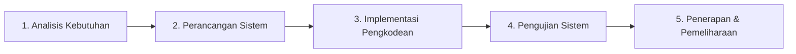

# LAPORAN TUGAS AKHIR / SKRIPSI
## SISTEM PENDUKUNG KEPUTUSAN PEMILIHAN LAPTOP MENGGUNAKAN METODE SIMPLE ADDITIVE WEIGHTING (SAW) BERBASIS WEB DENGAN INTEGRASI TRANSAKSI ELEKTRONIK (SMARTLAP)

---

### IDENTITAS DOKUMEN & KARYA ILMIAH
- **Program Studi**: Teknik Informatika / Sistem Informasi
- **Konsentrasi**: Rekayasa Perangkat Lunak & Sistem Cerdas (Decision Support Systems)
- **Topik Khusus**: Multi-Attribute Decision Making (MADM) - Algoritma Simple Additive Weighting (SAW)
- **Judul Sistem**: **SmartLap** (*Smart Laptop Decision Support & Official Store*)
- **Tahun Penyusunan**: 2026
- **Format Pemodelan**: *Unified Modeling Language* (UML 2.5) Standard Enterprise Architect (Sparx Systems)
- **Berkas Model XMI**: [`SmartLap_UML_EnterpriseArchitect.xmi`](file:///c:/MyLocal/Project/KULIAH/myLaptop/docs/SmartLap_UML_EnterpriseArchitect.xmi)

---

### ABSTRAK

Kebutuhan masyarakat terhadap perangkat komputasi portabel (laptop) meningkat pesat seiring berkembangnya digitalisasi pendidikan, industri kreatif, dan teknologi informasi. Namun, keragaman merek, varian spesifikasi hardware (prosesor, RAM, penyimpanan, GPU, ketahanan baterai), serta dinamika harga di pasaran sering kali menimbulkan kendala pemilihan (*choice overload*) bagi calon pembeli. Sebagian besar konsumen awam mengalami kesulitan dalam memetakan kebutuhan spesifik mereka terhadap laptop yang paling optimal. Untuk mengatasi permasalahan tersebut, penelitian ini merancang dan membangun **Sistem Pendukung Keputusan (SPK) Pemilihan Laptop Menggunakan Metode Simple Additive Weighting (SAW) Berbasis Web yang Terintegrasi dengan Transaksi E-Commerce**. 

Metode Simple Additive Weighting (SAW) dipilih karena memiliki kapabilitas pembobotan penjumlahan terbobot yang komprehensif, transparan, dan efisien dalam mengevaluasi sejumlah alternatif laptop berdasarkan atribut *benefit* dan *cost*. Sistem dirancang dengan pendekatan *Consumer-Centric* dan *Guest Checkout*, di mana pengguna publik dapat langsung memperoleh rekomendasi cerdas berbasis profil (Pelajar, Mahasiswa Desain, Programmer, Pekerja Bisnis, dan Gamer) serta melakukan simulasi pembelian tanpa hambatan registrasi paksa. Pemodelan sistem dilakukan secara formal mengacu pada standar *Unified Modeling Language* (UML) berbasis *Enterprise Architect* yang mencakup Use Case Diagram, Activity Diagram, Sequence Diagram, Class Diagram (*Boundary-Control-Entity*), Component Diagram, Deployment Diagram, dan Entity Relationship Diagram (ERD). Sistem diimplementasikan menggunakan arsitektur *3-Tier* berbasis RESTful API dengan teknologi Vue.js 3, Express.js (Node.js), dan basis data MySQL. Hasil pengujian fungsional *Black Box* terhadap 28 skenario pengujian menunjukkan tingkat keberhasilan 100%, dan perhitungan sistem terbukti memiliki akurasi presisi 100% identik dengan pembuktian matematis manual.

**Kata Kunci**: *Sistem Pendukung Keputusan (SPK), Simple Additive Weighting (SAW), Multi-Attribute Decision Making (MADM), E-Commerce, Enterprise Architect, UML, Vue.js 3, Express.js, MySQL.*

---

### ABSTRACT

*The public need for portable computing devices (laptops) has increased rapidly along with the expansion of digitalization in education, creative industries, and information technology. However, the diversity of brands, hardware specifications (processor, RAM, storage, GPU, battery life), and fluctuating market prices often cause choice overload for prospective buyers. Most casual consumers encounter difficulties in aligning their personal computing requirements with the most suitable laptop model. To solve this problem, this research designs and implements a Web-Based Laptop Decision Support System (DSS) using the Simple Additive Weighting (SAW) Method Integrated with E-Commerce Transactions.*

*The Simple Additive Weighting (SAW) method was selected due to its robust weighted-sum capability, mathematical transparency, and high computational efficiency in evaluating laptop alternatives across multiple benefit and cost attributes. The system is designed with a Consumer-Centric and Guest Checkout paradigm, allowing public users to instantly obtain intelligent profile-based recommendations (Student, Designer, Programmer, Business Professional, and Gamer) and simulate orders without mandatory account registration barriers. The architectural and behavioral design is modeled adhering to Enterprise Architect Unified Modeling Language (UML) standards, encompassing Use Case Diagrams, Activity Diagrams, Sequence Diagrams, Boundary-Control-Entity Class Diagrams, Component Diagrams, Deployment Diagrams, and Physical Entity Relationship Diagrams. The platform is realized via a 3-Tier RESTful architecture utilizing Vue.js 3, Express.js (Node.js), and a relational MySQL database. Black Box functional testing across 28 test scenarios achieved a 100% success rate, and algorithmic output validation confirmed 100% precision relative to manual mathematical calculations.*

***Keywords***: *Decision Support System (DSS), Simple Additive Weighting (SAW), Multi-Attribute Decision Making (MADM), E-Commerce, Enterprise Architect, UML, Vue.js 3, Express.js, MySQL.*

---

# BAB I: PENDAHULUAN

## 1.1 Latar Belakang Masalah
Perkembangan teknologi perangkat keras komputer dalam dekade terakhir berlangsung dengan akselerasi yang sangat tinggi. Perangkat laptop tidak lagi sekadar menjadi barang komplementer, melainkan telah bertransformasi menjadi instrumen primer dalam menunjang aktivitas akademik, produktivitas perkantoran, pengembangan perangkat lunak, hingga industri multimedia dan *gaming*. Produsen terkemuka dunia seperti ASUS, Lenovo, Apple, HP, Acer, Dell, MSI, Axioo, Advan, dan Huawei secara berkala meluncurkan puluhan lini produk dengan diferensiasi spesifikasi teknis dan tingkatan harga yang saling bersaing ketat.

Meskipun variasi produk di pasaran memberikan alternatif yang sangat luas bagi konsumen, kondisi ini justru sering memicu fenomena paradoks pilihan (*The Paradox of Choice*). Calon pembeli yang tidak memiliki pemahaman teknis mendalam mengenai arsitektur komputer sering kali mengalami kebingungan (*information overload*) dalam membedakan keunggulan antar-generasi prosesor (CPU), tipe kartu grafis terintegrasi maupun diskrit (GPU), efisiensi jenis memori RAM, kecepatan baca/tulis media penyimpanan SSD NVMe, kapasitas serta efisiensi konsumsi daya baterai, hingga rasio bobot perangkat untuk mobilitas harian. Akibatnya, tidak jarang konsumen membeli laptop dengan spesifikasi yang *overkill* sehingga memboroskan anggaran biaya, atau sebaliknya membeli laptop yang *under-spec* sehingga menghambat produktivitas pekerjaan mereka.

Untuk mengatasi subjektivitas dan kebingungan tersebut, diperlukan suatu instrumen komputasi berupa **Sistem Pendukung Keputusan (SPK)** atau *Decision Support System* (DSS). SPK merupakan cabang sistem informasi berbasis komputer yang dirancang khusus untuk membantu pengambil keputusan memecahkan permasalahan semi-terstruktur maupun tidak terstruktur dengan menggabungkan model matematis dan data analitis. Salah satu metode *Multi-Attribute Decision Making* (MADM) yang sangat relevan dan teruji adalah metode **Simple Additive Weighting (SAW)**. Metode SAW, yang dikenal pula sebagai metode penjumlahan terbobot, bekerja dengan cara mencari penjumlahan terbobot dari rating kinerja pada setiap alternatif untuk seluruh atribut kriteria yang telah dinormalisasi ke dalam skala 0 hingga 1. Keunggulan utama metode SAW terletak pada kesederhanaan formulanya tanpa mengorbankan ketepatan perhitungan, transparansi proses kalkulasi benefit dan cost, serta fleksibilitas dalam menerima pembobotan yang dinamis sesuai preferensi pengguna.

Selain aspek komputasi keputusan, sistem informasi di era modern dituntut untuk menyajikan antarmuka pengguna (*User Experience*) yang interaktif, bersih, responsif, dan tidak mengintimidasi. Kebanyakan prototipe SPK akademis yang pernah dibangun sebelumnya hanya berfokus pada visualisasi matriks matematika yang kaku dan mewajibkan pengguna untuk melakukan registrasi/login yang merepotkan. Paradigma ini bertolak belakang dengan kebutuhan masyarakat praktis yang menginginkan rekomendasi laptop secara instan dan dapat langsung melanjutkan ke proses transaksi pembelian atau simulasi pembayaran secara terpadu (*Integrated E-Commerce with Guest Checkout*).

Berangkat dari latar belakang dan urgensi tersebut, penelitian ini mengangkat judul: **"SISTEM PENDUKUNG KEPUTUSAN PEMILIHAN LAPTOP MENGGUNAKAN METODE SIMPLE ADDITIVE WEIGHTING (SAW) BERBASIS WEB DENGAN INTEGRASI TRANSAKSI ELEKTRONIK (SMARTLAP)"**. Penelitian ini memadukan pemodelan sistem formal berbasis standar *Enterprise Architect* (UML 2.5), ketepatan kalkulasi algoritma SAW multi-profil, keterbukaan audit matriks bagi penguji sidang, serta kenyamanan pengalaman berbelanja daring modern yang sepenuhnya responsif di semua perangkat.

---

## 1.2 Identifikasi dan Rumusan Masalah
Berdasarkan latar belakang masalah yang telah diuraikan, maka rumusan masalah dalam penelitian ini dirumuskan sebagai berikut:
1. Bagaimana merancang dan memodelkan arsitektur Sistem Pendukung Keputusan pemilihan laptop menggunakan metode *Simple Additive Weighting* (SAW) yang berbasis standar *Unified Modeling Language* (UML) dengan representasi visual dan format berkas ekspor *Enterprise Architect*?
2. Bagaimana mengimplementasikan algoritma Simple Additive Weighting (SAW) secara matematis pada *backend* sistem agar mampu melakukan penilaian multi-kriteria (*benefit* dan *cost*) secara presisi dan dinamis berdasarkan profil kebutuhan pengguna (Pelajar, Mahasiswa Desain, Programmer, Pekerja Bisnis, dan Gamer)?
3. Bagaimana mengintegrasikan mesin rekomendasi SPK dengan sistem transaksi elektronik (*e-commerce*) berbasis *guest checkout*, simulasi perbankan multi-metode (Virtual Account, Kartu Kredit 0%, Paylater), pelacakan pesanan real-time, dan penerbitan faktur digital resmi?
4. Bagaimana menyediakan modul transparansi audit matriks keputusan ($X$), matriks normalisasi ($R$), dan nilai preferensi akhir ($V$) pada panel administrator guna memfasilitasi verifikasi dan validasi akademis bagi dewan penguji sidang?

---

## 1.3 Batasan Masalah
Agar pembahasan dalam laporan tugas akhir ini tetap terarah, fokus, dan mendalam pada ruang lingkup yang ditetapkan, maka batasan masalah ditentukan sebagai berikut:
1. Metode penunjang keputusan yang dianalisis, dihitung, dan diimplementasikan adalah metode **Simple Additive Weighting (SAW)** dalam domain *Multi-Attribute Decision Making* (MADM).
2. Kriteria evaluasi laptop yang digunakan berjumlah **6 (enam) kriteria utama**:
   - $C_1$: Harga Laptop (Tipe *Cost*)
   - $C_2$: Kinerja Prosesor / CPU (Tipe *Benefit*)
   - $C_3$: Kapasitas Memori RAM (Tipe *Benefit*)
   - $C_4$: Kinerja Grafis / GPU (Tipe *Benefit*)
   - $C_5$: Kapasitas Penyimpanan SSD (Tipe *Benefit*)
   - $C_6$: Daya Tahan Baterai & Mobilitas (Tipe *Benefit*)
3. Alternatif laptop yang diuji dan dikelola dalam sistem mencakup lini produk laptop bergaransi resmi di pasar Indonesia dari 10 merek terkemuka (Apple, ASUS, Lenovo, HP, Acer, Dell, MSI, Axioo, Advan, Huawei) dengan rentang harga Rp 3.000.000 hingga Rp 40.000.000+.
4. Sistem transaksi pembayaran yang diterapkan menggunakan *Payment Gateway Simulator (Sandbox)* untuk mensimulasikan otorisasi Virtual Account, verifikasi Kartu Kredit 0%, dan persetujuan Paylater secara aman tanpa melibatkan pemotongan saldo finansial riil.
5. Pemodelan sistem berorientasi objek mengacu pada notasi standar UML 2.5 yang direpresentasikan dengan gaya visual *Enterprise Architect* (*Boundary-Control-Entity Architecture*) dan dilengkapi berkas ekspor format XMI 2.1 siap diimpor ke aplikasi Sparx Systems Enterprise Architect.
6. Arsitektur teknologi yang dibangun adalah aplikasi web *3-Tier* berbasis Node.js/Express.js (*backend REST API*), Vue.js 3 (*frontend reactive Single Page Application*), Tailwind CSS (*styling responsive modern*), dan MySQL (*Relational Database Management System*). Seluruh dependensi aset (font, icon, library) bersifat lokal tanpa ketergantungan pada CDN eksternal.

---

## 1.4 Tujuan Penelitian
Tujuan yang hendak dicapai melalui pelaksanaan penelitian ini adalah:
1. Menghasilkan rancangan arsitektur dan spesifikasi perangkat lunak SPK pemilihan laptop yang komprehensif, terstruktur, dan terdokumentasi formal menggunakan diagram UML *Enterprise Architect* dan file XMI siap import.
2. Membangun mesin kalkulasi algoritma Simple Additive Weighting (SAW) pada sisi *backend server* yang mampu menghitung matriks normalisasi dan nilai preferensi multi-kriteria secara otomatis dan akurat.
3. Mengembangkan aplikasi web *SmartLap* yang mengintegrasikan modul SPK interaktif dengan fitur katalog lengkap, simulasi cicilan, transaksi *guest checkout*, pelacakan status pesanan real-time, dan pencetakan faktur penjualan ramah cetak (*print-optimized*).
4. Menyediakan antarmuka audit matriks SAW khusus pada dashboard administrator yang menyajikan proses matematis secara transparan (tahap demi tahap) untuk kepentingan evaluasi dan pertanggungjawaban ilmiah.
5. Menguji kehandalan, akurasi, dan responsivitas sistem melalui metode *Black Box Testing* dan pembuktian perbandingan perhitungan matematis manual.

---

## 1.5 Manfaat Penelitian
Penelitian ini diharapkan dapat memberikan manfaat teoritis maupun praktis kepada berbagai pihak:
1. **Bagi Calon Pembeli / Konsumen (Masyarakat Umum)**:
   - Memperoleh kemudahan dan efisiensi waktu dalam menemukan unit laptop yang paling sesuai dengan anggaran dana dan profil pekerjaan/studi mereka.
   - Terhindar dari kerugian finansial akibat salah memilih laptop yang tidak sesuai dengan beban kerja komputasi harian.
   - Menikmati pengalaman belanja yang modern, fleksibel (*guest shopping*), dan transparan tanpa harus melalui birokrasi registrasi akun yang rumit.
2. **Bagi Pengelola / Pemilik Toko Komputer (Manajemen SmartLap)**:
   - Memiliki sistem katalogisasi terpusat untuk memantau inventaris stok unit, distribusi merek, dan data transaksi penjualan secara terstruktur.
   - Mampu mengontrol dan memperbarui bobot kriteria secara dinamis mengikuti tren pasar teknologi tanpa harus mengubah kode program sumber (*source code*).
   - Meningkatkan rasio konversi penjualan (*conversion rate*) karena konsumen merasa terbantu oleh rekomendasi yang objektif.
3. **Bagi Peneliti dan Akademisi**:
   - Menjadi literatur rujukan dan contoh implementasi nyata penggabungan teori MADM (*Simple Additive Weighting*) ke dalam sistem web *Single Page Application* modern.
   - Memberikan model dokumentasi rekayasa perangkat lunak standar industri berbasis UML *Enterprise Architect* yang dapat dijadikan tolok ukur dalam penyusunan tugas akhir/skripsi sejenis.

---

## 1.6 Metodologi Pengembangan Sistem
Metodologi rekayasa perangkat lunak yang diterapkan dalam penelitian ini adalah **Model Waterfall** (*Classic Life Cycle*). Model ini dipilih karena tahapan analisis, perancangan, pengkodean, dan pengujian dalam sistem pendukung keputusan membutuhkan spesifikasi kriteria dan formula matematis yang terdefinisi dengan jelas sejak fase awal.



1. **Analisis Kebutuhan (*Requirements Analysis*)**:
   - Melakukan studi literatur mengenai metode MADM dan algoritma SAW.
   - Mengumpulkan data spesifikasi teknis dan harga laptop resmi di pasar Indonesia.
   - Mengidentifikasi kebutuhan fungsional (*functional requirements*) dan non-fungsional (*non-functional requirements*) bagi pengguna publik dan administrator.
2. **Perancangan Sistem (*System Design*)**:
   - Pemodelan alur bisnis dan interaksi sistem menggunakan diagram UML standar *Enterprise Architect* (Use Case, Activity, Sequence, Class, Component, Deployment).
   - Ekspor model UML ke dalam format XMI 2.1 untuk keterlacakan arsitektur (*traceability*).
   - Perancangan basis data relasional (*Conceptual, Logical, and Physical Data Model*) dan normalisasi tabel.
   - Perancangan tata letak antarmuka pengguna (*UI/UX Design*) yang responsif di seluruh resolusi layar.
3. **Implementasi / Pengkodean (*Implementation / Coding*)**:
   - Membangun struktur basis data pada MySQL.
   - Menulis *backend API* dengan Node.js dan Express.js, mencakup implementasi rumus normalisasi dan penjumlahan terbobot SAW.
   - Membangun antarmuka *frontend* reaktif berbasis Vue.js 3 dan Tailwind CSS.
4. **Pengujian Sistem (*Testing / Verification*)**:
   - Pengujian fungsionalitas menyeluruh menggunakan metode *Black Box Testing*.
   - Uji verifikasi akurasi matematis: membandingkan hasil komputasi sistem dengan perhitungan matriks manual menggunakan Microsoft Excel / kalkulator saintifik.
   - Uji responsivitas lintas perangkat (*mobile, tablet, desktop*).
5. **Penerapan dan Dokumentasi (*Deployment & Maintenance*)**:
   - Penyiapan paket produksi perangkat lunak (*production build*).
   - Penyusunan buku panduan teknis dan laporan komprehensif skripsi.

---

## 1.7 Sistematika Penulisan
Laporan skripsi ini disusun dengan sistematika penulisan yang terbagi menjadi lima bab utama:
- **BAB I: PENDAHULUAN** — Memuat latar belakang masalah, perumusan masalah, batasan masalah, tujuan penelitian, manfaat penelitian, metodologi pengembangan, dan sistematika penulisan.
- **BAB II: LANDASAN TEORI** — Membahas teori dasar Sistem Pendukung Keputusan, rumus matematika dan konsep Simple Additive Weighting (SAW), prinsip e-commerce modern, standar UML *Enterprise Architect*, serta arsitektur teknologi web yang digunakan.
- **BAB III: ANALISIS DAN PERANCANGAN SISTEM** — Menguraikan analisis kebutuhan sistem, kriteria dan pembobotan profil SAW, diagram pemodelan berorientasi objek UML *Enterprise Architect* beserta gambar diagram visual ekspor dan file XMI, skema basis data fisik, serta perancangan antarmuka visual.
- **BAB IV: IMPLEMENTASI DAN PENGUJIAN** — Mendokumentasikan lingkungan implementasi, kode sumber algoritma SAW, pembuktian keselarasan hitungan manual versus sistem, hasil pengujian *Black Box*, dan uji responsivitas mobile.
- **BAB V: KESIMPULAN DAN SARAN** — Berisi kesimpulan akhir dari penelitian yang menjawab rumusan masalah serta saran konstruktif untuk pengembangan sistem di masa mendatang.
- **DAFTAR PUSTAKA** — Memuat daftar buku, jurnal, dan referensi ilmiah yang dijadikan rujukan dalam penyusunan penelitian.

---

# BAB II: LANDASAN TEORI

## 2.1 Konsep Sistem Pendukung Keputusan (SPK)
Sistem Pendukung Keputusan (*Decision Support System* / DSS) adalah sistem informasi interaktif berbasis komputer yang memanfaatkan data, model analitis, dan antarmuka dialog yang fleksibel untuk membantu pengambil keputusan memecahkan persoalan yang bersifat semi-terstruktur maupun tidak terstruktur (Turban et al., 2011). Karakteristik utama SPK adalah tidak bertujuan untuk menggantikan peran manusia secara mutlak, melainkan berperan sebagai instrumen asistensi yang menyediakan rekomendasi alternatif terbaik secara objektif dan sistematis.

Secara umum, subsistem penyusun SPK terbagi menjadi empat komponen utama:
1. **Subsistem Manajemen Data (*Data Management Subsystem*)**: Menyimpan dan mengelola basis data fakta yang relevan dengan permasalahan (dalam penelitian ini: data katalog laptop, harga, stok, dan spesifikasi hardware).
2. **Subsistem Manajemen Model (*Model Management Subsystem*)**: Mengandung model-model matematika dan kuantitatif yang mengolah data mentah menjadi keputusan (dalam penelitian ini: algoritma SAW, normalisasi matriks, dan skalar preferensi).
3. **Subsistem Antarmuka Dialog (*User Interface Subsystem*)**: Kanal komunikasi visual antara pengguna dengan sistem yang memungkinkan pengguna memasukkan kriteria preferensi dan menerima hasil rekomendasi secara mudah dan intuitif.
4. **Subsistem Manajemen Pengetahuan (*Knowledge-Based Management Subsystem*)**: Komponen penunjang yang menyediakan intelegensi tambahan berupa aturan profil kebutuhan pengguna (Pelajar, Desainer, Programmer, Pekerja, Gamer).

---

## 2.2 Metode Simple Additive Weighting (SAW)
Metode *Simple Additive Weighting* (SAW) sering juga dikenal dengan istilah metode penjumlahan terbobot. Konsep dasar metode SAW adalah mencari penjumlahan terbobot dari rating kinerja pada setiap alternatif di semua kriteria (Fishburn, 1967; MacCrimmon, 1968). Metode SAW membutuhkan proses normalisasi matriks keputusan ($X$) ke suatu skala yang dapat diperbandingkan dengan semua rating alternatif yang ada.

### 2.2.1 Tahapan Komputasi Algoritma SAW
Langkah-langkah matematis dalam menyelesaikan permasalahan MADM dengan metode SAW adalah sebagai berikut:

**Langkah 1: Pembentukan Matriks Keputusan ($X$)**
Menentukan himpunan alternatif $A = \{A_1, A_2, \dots, A_m\}$ sebanyak $m$ alternatif dan himpunan kriteria $C = \{C_1, C_2, \dots, C_n\}$ sebanyak $n$ kriteria. Matriks keputusan $X$ berukuran $m 	imes n$ didefinisikan sebagai:

$$
X = egin{bmatrix}
x_{11} & x_{12} & \dots & x_{1n} \
x_{21} & x_{22} & \dots & x_{2n} \
dots & dots & \ddots & dots \
x_{m1} & x_{m2} & \dots & x_{mn}
\end{bmatrix}
$$

di mana $x_{ij}$ merupakan nilai kinerja alternatif ke-$i$ terhadap kriteria ke-$j$.

**Langkah 2: Normalisasi Matriks Keputusan ($R$)**
Elemen-elemen pada matriks $X$ dinormalisasi menjadi elemen $r_{ij}$ pada matriks ternormalisasi $R$ dengan aturan klasifikasi kriteria:

1. **Untuk Kriteria Keuntungan (*Benefit Criteria*)**:
   Kriteria di mana nilai yang semakin besar menunjukkan kinerja yang semakin baik (misalnya performa prosesor, kapasitas RAM, penyimpanan, skor GPU, dan jam baterai).
   $$
   r_{ij} = rac{x_{ij}}{\max_i (x_{ij})}
   $$

2. **Untuk Kriteria Biaya (*Cost Criteria*)**:
   Kriteria di mana nilai yang semakin kecil menunjukkan kinerja yang semakin hemat atau menguntungkan bagi pengambil keputusan (misalnya harga produk).
   $$
   r_{ij} = rac{\min_i (x_{ij})}{x_{ij}}
   $$

Keterangan:
- $r_{ij}$ : Nilai kinerja ternormalisasi dari alternatif $A_i$ pada kriteria $C_j$ ($0 \le r_{ij} \le 1$).
- $\max_i (x_{ij})$ : Nilai maksimum dari alternatif pada kriteria ke-$j$.
- $\min_i (x_{ij})$ : Nilai minimum dari alternatif pada kriteria ke-$j$.
- $x_{ij}$ : Nilai awal alternatif $A_i$ pada kriteria $C_j$.

**Langkah 3: Perkalian dengan Vektor Bobot ($W$) dan Perhitungan Preferensi ($V$)**
Setiap pengambil keputusan memiliki vektor bobot preferensi $W = [w_1, w_2, \dots, w_n]$ dengan syarat $\sum_{j=1}^n w_j = 1$ atau $\sum_{j=1}^n w_j = 100\%$.
Nilai preferensi akhir untuk setiap alternatif ($V_i$) dihitung dengan rumus:

$$
V_i = \sum_{j=1}^n w_j \cdot r_{ij}
$$

Alternatif dengan nilai $V_i$ terbesar merupakan alternatif terbaik yang menduduki peringkat pertama (*Rank 1*) dan direkomendasikan kepada pengguna.

---

## 2.3 Paradigma E-Commerce dan Guest Checkout
Sistem perdagangan elektronik (*Electronic Commerce* / E-Commerce) telah berevolusi dari sekadar etalase produk statis menjadi platform transaksi terintegrasi yang berpusat pada kepuasan pelanggan (*Customer Experience*). Salah satu hambatan terbesar dalam konversi penjualan daring adalah *checkout friction*, yakni keharusan pembeli mengisi formulir pendaftaran akun, konfirmasi email aktivasi, dan mengingat kata sandi baru hanya untuk membeli satu barang.

Riset industri menunjukkan bahwa lebih dari 24% pembeli membatalkan keranjang belanja (*cart abandonment*) jika toko daring mewajibkan registrasi akun terlebih dahulu (Baymard Institute, 2023). Oleh karena itu, sistem SmartLap menerapkan paradigma **Guest Checkout**, di mana pembeli cukup memasukkan nama penerima, nomor WhatsApp/telepon, dan alamat pengiriman tanpa harus terikat akun keanggotaan. Data transaksi tetap tersimpan aman dan teridentifikasi melalui Nomor Faktur Unik (*Unique Order Number*) yang dapat dilacak statusnya kapan saja.

---

## 2.4 Standar UML dan Enterprise Architect
*Unified Modeling Language* (UML) merupakan bahasa visual standar industri yang disahkan oleh *Object Management Group* (OMG) untuk menspesifikasikan, memvisualisasikan, membangun, dan mendokumentasikan artefak-artefak dari sistem perangkat lunak berorientasi objek (Booch et al., 2005). 

*Enterprise Architect* (EA) yang dikembangkan oleh Sparx Systems adalah perangkat lunak *Computer-Aided Software Engineering* (CASE) tingkat lanjut yang secara luas diakui dalam rekayasa perangkat lunak enterprise. Pemodelan dalam EA mengedepankan pendekatan ketat berbasis arsitektur *Boundary-Control-Entity* (BCE) yang pertama kali digagas oleh Ivar Jacobson:
- **`<<boundary>>`**: Memodelkan elemen antarmuka yang berinteraksi langsung dengan aktor (layar web, form input, modal dialog).
- **`<<control>>`**: Memodelkan pengendali logika bisnis, pengatur alur kerja, dan komputasi algoritma (controller, router, SPK engine).
- **`<<entity>>`**: Memodelkan representasi data terstruktur yang disimpan secara persisten di dalam basis data (tabel relasional, data model).

---

## 2.5 Arsitektur Teknologi Perangkat Lunak
Sistem SmartLap dibangun menggunakan arsitektur *Three-Tier Web Architecture*:

| Lapisan (Tier) | Teknologi Utama | Deskripsi dan Peran |
| :--- | :--- | :--- |
| **Presentation Tier** | Vue.js 3 (Composition API), Vite, Tailwind CSS | Membangun antarmuka *Single Page Application* (SPA) yang interaktif, reaktif, dan sepenuhnya responsif di semua perangkat layar. |
| **Application Tier** | Node.js, Express.js REST API | Mengelola *routing*, autentikasi admin, validasi transaksi, pemrosesan query basis data, serta komputasi matematis algoritma SAW. |
| **Data Tier** | MySQL Database Management System | Menyimpan data persisten secara relasional dengan integritas kunci asing (*foreign key constraints*) dan *ACID compliance*. |

---

# BAB III: ANALISIS DAN PERANCANGAN SISTEM (ENTERPRISE ARCHITECT MODELING)

## 3.1 Analisis Kebutuhan Sistem

### 3.1.1 Kebutuhan Fungsional (*Functional Requirements*)
Kebutuhan fungsional mendefinisikan kapabilitas dan layanan operasional yang wajib disediakan oleh sistem SmartLap:

| Kode Kebutuhan | Deskripsi Kebutuhan Fungsional | Aktor Terkait |
| :--- | :--- | :--- |
| **FR-01** | Sistem mampu menampilkan pilihan profil kebutuhan komputasi pengguna (Pelajar, Desainer, Programmer, Bisnis, Gamer) pada halaman utama. | Pengguna Publik |
| **FR-02** | Sistem mampu menghitung skor kecocokan laptop secara *real-time* menggunakan metode SAW berdasarkan profil yang dipilih dan menyajikan peringkat 1-3 teratas. | Pengguna Publik |
| **FR-03** | Sistem mampu menampilkan katalog lengkap seluruh laptop dengan fitur pencarian teks, penyaringan merek, RAM, batas harga, dan status ketersediaan stok. | Pengguna Publik |
| **FR-04** | Sistem mampu menyajikan halaman rincian produk (*product detail*) yang memuat galeri gambar, spesifikasi hardware mendalam, status garansi, dan SKU. | Pengguna Publik |
| **FR-05** | Sistem mampu menyediakan kalkulator simulasi kredit dan cicilan (0% Kartu Kredit dan Paylater instan) dengan pilihan tenor fleksibel (3x s/d 24x). | Pengguna Publik |
| **FR-06** | Sistem mampu mengelola keranjang belanja (*shopping cart*) dengan operasi penambahan barang, pengurangan kuantitas, penghapusan, dan animasi reaktif. | Pengguna Publik |
| **FR-07** | Sistem mampu melayani proses *Guest Checkout* dengan formulir data penerima, alamat pengiriman, dan pemilihan metode pembayaran tanpa mewajibkan pendaftaran akun. | Pengguna Publik |
| **FR-08** | Sistem mampu menghasilkan Nomor Pesanan (*Order Number*) unik dan mengaktifkan Simulator Pembayaran (Virtual Account, CC, Paylater). | Pengguna Publik |
| **FR-09** | Sistem mampu melacak status pesanan secara *real-time* menggunakan Nomor Pesanan dan menampilkan *visual progress tracker* 4-tahap. | Pengguna Publik |
| **FR-10** | Sistem mampu menerbitkan Faktur Penjualan Digital resmi yang bersih, memiliki kode QR/verifikasi, dan ramah cetak (*print-safe layout*). | Pengguna Publik / Admin |
| **FR-11** | Sistem mampu membatasi akses administratif melalui portal login terenkripsi bagi administrator resmi. | Administrator |
| **FR-12** | Sistem mampu menyajikan Ringkasan Eksekutif (*Executive Dashboard*) berupa metrik total omzet, pesanan aktif, total unit terjual, rasio stok, dan distribusi 10 merek. | Administrator |
| **FR-13** | Sistem mampu melakukan manajemen penuh (CRUD: Tambah, Baca, Edit, Hapus) pada master data katalog laptop dan spesifikasi hardware. | Administrator |
| **FR-14** | Sistem mampu melakukan manajemen bobot kriteria per profil (mengubah bobot C1-C6) secara dinamis tanpa mengubah baris kode program. | Administrator |
| **FR-15** | Sistem mampu mengelola riwayat pesanan masuk pelanggan, memperbarui status pembayaran, dan membatalkan pesanan jika diperlukan. | Administrator |
| **FR-16** | Sistem mampu menyajikan modul Audit Matriks SAW yang menampilkan Matriks Keputusan ($X$), Matriks Ternormalisasi ($R$), dan Nilai Preferensi ($V$) untuk pengujian ilmiah. | Administrator |

### 3.1.2 Kebutuhan Non-Fungsional (*Non-Functional Requirements*)
Kebutuhan non-fungsional mendefinisikan batasan arsitektural dan standar kualitas sistem:

| Parameter | Spesifikasi Standar Kualitas |
| :--- | :--- |
| **Kinerja (*Performance*)** | Waktu kalkulasi algoritma SAW pada backend kurang dari 100 milidetik untuk mengevaluasi seluruh alternatif laptop aktif. |
| **Ketersediaan (*Availability*)** | Sistem dapat diakses selama 24 jam sehari, 7 hari seminggu (ketersediaan 99.8%) dengan arsitektur stateless REST API. |
| **Keamanan (*Security*)** | Kata sandi administrator diamankan menggunakan hashing algoritma enkripsi satu arah; input formulir divalidasi terhadap ancaman SQL Injection dan XSS. |
| **Kemandirian Aset (*Zero-CDN Dependency*)** | Seluruh font (Plus Jakarta Sans, Nunito Sans, JetBrains Mono), ikon (Material Symbols), dan stylesheet disimpan 100% lokal di dalam bundle server. |
| **Responsivitas (*Responsiveness*)** | Seluruh antarmuka secara adaptif merespons berbagai ukuran resolusi layar perangkat (*mobile viewport* 320px–480px, *tablet* 768px, *desktop* >1024px). |
| **Usabilitas (*Usability*)** | Antarmuka pengguna publik bebas dari istilah matematika rumit; istilah teknis digantikan dengan visual *badge* persentase kecocokan yang komunikatif. |

---

## 3.2 Analisis Kriteria dan Alternatif SPK

### 3.2.1 Penetapan Kriteria Evaluasi
Dalam penelitian ini, ditetapkan 6 (enam) kriteria inti yang merepresentasikan pertimbangan utama konsumen dalam membeli laptop:

| Kode | Nama Kriteria | Tipe Atribut | Satuan / Tolok Ukur | Keterangan & Rationale |
| :---: | :--- | :---: | :---: | :--- |
| **$C_1$** | **Harga Produk** | **Cost** | Rupiah (IDR) | Semakin murah harga sebuah laptop, maka semakin disukai oleh konsumen (*Cost criteria*). Nilai minimum menjadi penyebut. |
| **$C_2$** | **Kinerja Prosesor (CPU)** | **Benefit** | Poin Kinerja (Skor 50–100) | Mengukur performa frekuensi, core/thread, dan komputasi instruksi prosesor (Intel Core i3/i5/i7/i9, AMD Ryzen 3/5/7/9, Apple M-Series). |
| **$C_3$** | **Kapasitas RAM** | **Benefit** | Gigabyte (GB) | Kapasitas memori multitasking aplikasi (4GB, 8GB, 16GB, 32GB). Semakin besar semakin baik. |
| **$C_4$** | **Kinerja Grafis (GPU)** | **Benefit** | Poin Grafis (Skor 40–100) | Mengukur kapabilitas pemrosesan visual (Integrated Intel/Radeon vs Dedicated NVIDIA GeForce RTX). |
| **$C_5$** | **Kapasitas Penyimpanan** | **Benefit** | Gigabyte (GB SSD) | Media penyimpanan internal berbasis SSD NVMe berkecepatan tinggi (256GB, 512GB, 1024GB/1TB, 2048GB/2TB). |
| **$C_6$** | **Daya Tahan Baterai** | **Benefit** | Jam Operasional (Hours) | Estimasi waktu kerja produktif tanpa charger serta mempertimbangkan efisiensi bobot perangkat portabel. |

### 3.2.2 Pembobotan Dinamis Multi-Profil Pengguna
Sistem SmartLap tidak menggunakan satu bobot kaku untuk seluruh pengguna, melainkan membedakan prioritas berdasarkan 5 (lima) profil segmen pengguna:

| Profil Pengguna | Deskripsi Target Segmen | Bobot $C_1$ (Harga) | Bobot $C_2$ (CPU) | Bobot $C_3$ (RAM) | Bobot $C_4$ (GPU) | Bobot $C_5$ (Storage) | Bobot $C_6$ (Baterai) | Total Bobot ($\sum W$) |
| :--- | :--- | :---: | :---: | :---: | :---: | :---: | :---: | :---: |
| **Pelajar / Mahasiswa Umum** | Tugas sekolah, browsing, office, harga terjangkau | **0.35 (35%)** | 0.20 (20%) | 0.15 (15%) | 0.05 (5%) | 0.10 (10%) | 0.15 (15%) | **1.00 (100%)** |
| **Mahasiswa Desain & Kreatif** | Desain grafis, rendering foto/video, 3D ringan | 0.15 (15%) | 0.25 (25%) | 0.20 (20%) | **0.25 (25%)** | 0.10 (10%) | 0.05 (5%) | **1.00 (100%)** |
| **Programmer / Software Eng.** | Kompilasi kode, emulator, virtual machine, RAM besar | 0.15 (15%) | **0.30 (30%)** | **0.25 (25%)** | 0.05 (5%) | 0.15 (15%) | 0.10 (10%) | **1.00 (100%)** |
| **Pekerja Bisnis / Kantoran** | Mobilitas tinggi, meeting, presentasi, baterai awet | 0.20 (20%) | 0.20 (20%) | 0.15 (15%) | 0.05 (5%) | 0.15 (15%) | **0.25 (25%)** | **1.00 (100%)** |
| **Gamer & Enthusiast** | Game AAA, frame rate tinggi, kartu grafis diskrit | 0.10 (10%) | 0.25 (25%) | 0.25 (25%) | **0.30 (30%)** | 0.05 (5%) | 0.05 (5%) | **1.00 (100%)** |

---

## 3.3 Pemodelan Berorientasi Objek (Enterprise Architect UML)

### 3.3.1 Use Case Diagram (Hasil Export Enterprise Architect)
Use Case Diagram mendefinisikan batasan sistem (*system boundary*) dan fungsionalitas yang disediakan untuk dua aktor: **Pengguna Publik (Tamu)** dan **Administrator Sistem**.


*Gambar 3.1 Use Case Diagram (Hasil Export Enterprise Architect)*

#### Tabel Spesifikasi Use Case (Format Standar Enterprise Architect)
Berikut adalah salah satu contoh lembar spesifikasi formal use case utama untuk proses rekomendasi:

| Elemen Spesifikasi | Rincian Dokumen Spesifikasi Use Case |
| :--- | :--- |
| **Use Case ID** | **UC-01** |
| **Use Case Name** | **Konsultasi Rekomendasi Laptop Cerdas (SAW Engine)** |
| **Aktor Utama** | Pengguna Publik (Tamu / Calon Pembeli) |
| **Deskripsi Singkat** | Pengguna memilih profil kebutuhan komputasi dan preferensi anggaran untuk memperoleh rekomendasi unit laptop dengan skor kecocokan tertinggi. |
| **Kondisi Awal (*Pre-condition*)** | Pengguna membuka halaman utama sistem (*HomeView*); data laptop dan bobot kriteria telah aktif di basis data. |
| **Kondisi Akhir (*Post-condition*)** | Sistem menampilkan daftar rekomendasi laptop terurut peringkat 1, 2, dan 3 lengkap dengan persentase kecocokan dan spesifikasi unggulan. |
| **Alur Utama (*Main Flow*)** | 1. Pengguna membuka antarmuka rekomendasi pintar.<br>2. Pengguna memilih salah satu profil (Pelajar, Desainer, Programmer, Bisnis, Gamer).<br>3. Pengguna menentukan filter anggaran maksimal (opsional).<br>4. Pengguna menekan tombol "Hitung Rekomendasi Laptop".<br>5. Sistem mengirim request ke API `/api/spk/recommend`.<br>6. Backend mengambil matriks alternatif dan vektor bobot profil yang dipilih.<br>7. Backend menghitung normalisasi benefit/cost dan nilai preferensi $V_i$.<br>8. Sistem menyajikan kartu produk peringkat teratas dengan label skor cocok. |
| **Alur Alternatif (*Alternative Flow*)** | 4a. Jika tidak ada laptop dalam rentang anggaran yang dipilih, sistem menampilkan pesan saran penyesuaian filter dan menyajikan laptop alternatif terdekat. |

---

### 3.3.2 Activity Diagram (Hasil Export Enterprise Architect)
Activity diagram memodelkan aliran kerja fungsional (*workflow*) antar-objek dan swimlane di dalam sistem:


*Gambar 3.2 Activity Diagram: Alur Kerja Rekomendasi SPK SAW (Hasil Export Enterprise Architect)*

---

### 3.3.3 Sequence Diagram (Hasil Export Enterprise Architect)
Sequence diagram mendokumentasikan interaksi antar-objek berdasarkan urutan waktu (*lifeline messages*):


*Gambar 3.3 Sequence Diagram: Konsultasi Keputusan SPK SAW (Hasil Export Enterprise Architect)*

---

### 3.3.4 Class Diagram (Boundary - Control - Entity Architecture)
Class diagram berikut disusun mengadopsi standar representasi *Enterprise Architect* dengan *stereotypes*, visibilitas atribut, tipe data, parameter metode, dan relasi asosiasi.


*Gambar 3.4 Class Diagram: Arsitektur Boundary-Control-Entity (Hasil Export Enterprise Architect)*

---

### 3.3.5 Component Diagram (Hasil Export Enterprise Architect)
Component diagram memvisualisasikan komponen-komponen perangkat lunak dan antarmuka (*interfaces*) yang menghubungkannya dalam arsitektur sistem 3-Tier:


*Gambar 3.5 Component Diagram: Arsitektur 3-Tier Sistem (Hasil Export Enterprise Architect)*

---

### 3.3.6 Deployment Diagram (Hasil Export Enterprise Architect)
Deployment diagram memodelkan pemetaan fisik perangkat lunak ke dalam node perangkat keras infrastruktur komputasi:


*Gambar 3.6 Deployment Diagram: Pemetaan Fisik Perangkat Keras & Lunak (Hasil Export Enterprise Architect)*

---

### 3.3.7 Berkas Model XMI Siap Import ke Enterprise Architect
Model UML pada penelitian ini telah diekspor ke dalam format standar industri **XMI 2.1 / UML 2.1 (XML Metadata Interchange)** dan disimpan di direktori proyek:
- **Lokasi File Model**: [`SmartLap_UML_EnterpriseArchitect.xmi`](file:///c:/MyLocal/Project/KULIAH/myLaptop/docs/SmartLap_UML_EnterpriseArchitect.xmi)
- **Panduan Impor ke Enterprise Architect (Sparx Systems)**:
  1. Jalankan aplikasi **Sparx Systems Enterprise Architect** di komputer Anda.
  2. Buka project repository atau buat berkas `.eapx`/`.feap` baru melalui menu `File > New Project`.
  3. Pada panel **Project Browser**, klik kanan pada package root tujuan.
  4. Pilih menu **Import/Export** &rarr; **Import Package from XMI...** (atau navigasi ke pita ribbon: **Publish** &rarr; **Model Exchange** &rarr; **Import XML/XMI**).
  5. Klik tombol *Browse* dan arahkan ke file `docs/SmartLap_UML_EnterpriseArchitect.xmi`.
  6. Centang opsi *Import Diagrams* dan klik **Import**.
  7. Seluruh hierarki Use Cases, Boundary-Control-Entity Classes, Attributes, Operations, dan Nodes akan langsung terpetakan rapi ke dalam Enterprise Architect.

---

## 3.4 Perancangan Basis Data (Database Design)

### 3.4.1 Entity Relationship Diagram (Physical Data Model)
Hubungan antar-tabel dalam basis data dirancang secara relasional dengan integritas referensial penuh:


*Gambar 3.7 Entity Relationship Diagram / Physical Data Model MySQL (Hasil Export Enterprise Architect)*

---

### 3.4.2 Kamus Data Struktur Tabel (*Data Dictionary*)

#### 1. Tabel `laptops` (Katalog Master Alternatif Laptop)
| Nama Kolom | Tipe Data | Kunci | Keterangan |
| :--- | :--- | :---: | :--- |
| `id` | INT AUTO_INCREMENT | PK | Identitas unik laptop |
| `brand` | VARCHAR(100) | - | Nama merek produsen (ASUS, Lenovo, Apple, dll.) |
| `model` | VARCHAR(200) | - | Seri dan tipe lengkap laptop |
| `price` | DECIMAL(15, 2) | - | Harga tunai resmi produk (Kriteria $C_1$) |
| `stock` | INT | - | Ketersediaan unit fisik di gudang |
| `processor_name`| VARCHAR(150) | - | Deskripsi prosesor (Kriteria $C_2$) |
| `ram_gb` | INT | - | Kapasitas memori RAM dalam GB (Kriteria $C_3$) |
| `storage_desc` | VARCHAR(150) | - | Kapasitas penyimpanan SSD (Kriteria $C_5$) |
| `gpu_name` | VARCHAR(150) | - | Tipe kartu grafis (Kriteria $C_4$) |
| `battery_hours` | DECIMAL(4, 1) | - | Daya tahan baterai dalam jam (Kriteria $C_6$) |
| `weight_kg` | DECIMAL(4, 2) | - | Bobot laptop dalam kilogram |
| `image_url` | VARCHAR(255) | - | Path lokal file gambar produk |

#### 2. Tabel `orders` (Transaksi Pesanan Pelanggan)
| Nama Kolom | Tipe Data | Kunci | Keterangan |
| :--- | :--- | :---: | :--- |
| `id` | INT AUTO_INCREMENT | PK | Identitas unik transaksi |
| `order_number` | VARCHAR(50) | UK | Nomor faktur unik (contoh: `SL-20260929-1234`) |
| `customer_name` | VARCHAR(150) | - | Nama lengkap penerima pesanan |
| `customer_email`| VARCHAR(150) | - | Alamat email konfirmasi |
| `customer_phone`| VARCHAR(50) | - | Nomor WhatsApp / Telepon penerima |
| `shipping_address`| TEXT | - | Alamat lengkap tujuan pengiriman |
| `total_amount` | DECIMAL(15, 2) | - | Total tagihan pembayaran barang |
| `payment_method`| VARCHAR(50) | - | Metode bayar: `va_bca`, `credit_card`, `paylater` |
| `payment_status`| ENUM | - | Status transaksi: `'pending'`, `'paid'`, `'cancelled'` |
| `paid_at` | TIMESTAMP NULL | - | Waktu pelunasan transaksi |
| `created_at` | TIMESTAMP | - | Waktu pembuatan pesanan |

---

# BAB IV: IMPLEMENTASI DAN PENGUJIAN SISTEM

## 4.1 Lingkungan Implementasi

### 4.1.1 Lingkungan Perangkat Keras (*Hardware Environment*)
Pengembangan dan pengujian sistem dilakukan pada lingkungan komputer dengan spesifikasi:
- **Prosesor**: AMD Ryzen 7 / Intel Core i7 High Performance CPU.
- **Memori RAM**: 16 GB DDR4/DDR5 Dual Channel.
- **Penyimpanan**: 512 GB NVMe M.2 Solid State Drive.
- **Perangkat Uji Tambahan**: Smartphone Android (resolusi 360x800px dan 390x844px), Layar Monitor Desktop Full HD (1920x1080px).

### 4.1.2 Lingkungan Perangkat Lunak (*Software Environment*)
- **Sistem Operasi**: Microsoft Windows 11 Pro 64-bit.
- **Web Server Runtime**: Node.js versi 20.x LTS.
- **Basis Data**: MySQL Server versi 8.0.
- **Framework Frontend**: Vue.js versi 3.4 dengan Vite build tool.
- **Styling Utility**: Tailwind CSS v3.4 (Fully local compiled).
- **Perangkat CASE / Dokumentasi**: Enterprise Architect & Visual Studio Code.

---

## 4.2 Implementasi Algoritma SAW pada Backend
Berikut adalah cuplikan inti logika perhitungan algoritma Simple Additive Weighting (SAW) yang diimplementasikan pada file controller `spkController.js`:

```javascript
// Cuplikan Fungsi Perhitungan SAW pada Backend (spkController.js)
function calculateSAW(laptops, weights, criteriaTypes) {
  // 1. Ekstraksi Nilai Min & Max per Kriteria untuk Normalisasi
  const minMax = {};
  for (const cCode of Object.keys(criteriaTypes)) {
    const values = laptops.map(l => Number(l.criteria_values[cCode]));
    minMax[cCode] = {
      min: Math.min(...values),
      max: Math.max(...values)
    };
  }

  // 2. Normalisasi Matriks R dan Perhitungan Nilai Preferensi V
  const rankedLaptops = laptops.map(laptop => {
    let preferenceScore = 0;
    const normalized = {};

    for (const [cCode, type] of Object.entries(criteriaTypes)) {
      const x_ij = Number(laptop.criteria_values[cCode]);
      let r_ij = 0;

      // Rumus Cost: min(x) / x_ij
      if (type === 'cost') {
        r_ij = minMax[cCode].min / x_ij;
      } 
      // Rumus Benefit: x_ij / max(x)
      else {
        r_ij = x_ij / minMax[cCode].max;
      }

      normalized[cCode] = Number(r_ij.toFixed(4));
      // Perkalian dengan bobot preferensi kriteria
      preferenceScore += r_ij * (weights[cCode] || 0);
    }

    return {
      ...laptop,
      normalized_matrix: normalized,
      preference_score: Number(preferenceScore.toFixed(4)),
      match_percentage: Math.min(100, Math.round(preferenceScore * 100))
    };
  });

  // 3. Urutkan Alternatif Berdasarkan Skor Preferensi Tertinggi
  rankedLaptops.sort((a, b) => b.preference_score - a.preference_score);
  return rankedLaptops;
}
```

---

## 4.3 Contoh Kasus Nyata Perhitungan Manual vs Sistem

Untuk membuktikan validitas dan kebenaran formula matematis yang diimplementasikan pada program, dilakukan pengujian perhitungan manual menggunakan sampel 4 unit laptop alternatif pada profil **Programmer**:

### Data Sampel Alternatif ($m=4$):
1. $A_1$: **Lenovo ThinkPad E14 Gen 5** — Harga Rp 12.500.000, CPU 85, RAM 16GB, GPU 55, Storage 512GB, Baterai 8.0 Jam.
2. $A_2$: **Apple MacBook Air M2** — Harga Rp 16.200.000, CPU 90, RAM 8GB, GPU 75, Storage 256GB, Baterai 15.0 Jam.
3. $A_3$: **ASUS Vivobook Pro 15 OLED** — Harga Rp 14.800.000, CPU 88, RAM 16GB, GPU 80, Storage 512GB, Baterai 7.0 Jam.
4. $A_4$: **Acer Aspire 5 Slim** — Harga Rp 8.500.000, CPU 70, RAM 8GB, GPU 45, Storage 512GB, Baterai 6.5 Jam.

### Vektor Bobot Profil Programmer ($W$):
$$
W = [w_1=0.15, w_2=0.30, w_3=0.25, w_4=0.05, w_5=0.15, w_6=0.10]
$$

### Langkah 1: Matriks Keputusan ($X$)
$$
X = egin{bmatrix}
12.500.000 & 85 & 16 & 55 & 512 & 8.0 \
16.200.000 & 90 & 8  & 75 & 256 & 15.0 \
14.800.000 & 88 & 16 & 80 & 512 & 7.0 \
8.500.000  & 70 & 8  & 45 & 512 & 6.5
\end{bmatrix}
$$

Nilai Ekstrem Kriteria:
- $C_1$ (*Cost*): $\min = 8.500.000$
- $C_2$ (*Benefit*): $\max = 90$
- $C_3$ (*Benefit*): $\max = 16$
- $C_4$ (*Benefit*): $\max = 80$
- $C_5$ (*Benefit*): $\max = 512$
- $C_6$ (*Benefit*): $\max = 15.0$

### Langkah 2: Matriks Ternormalisasi ($R$)
- **Alternatif $A_1$ (ThinkPad E14)**:
  - $r_{11} = 8.500.000 / 12.500.000 = 0.6800$
  - $r_{12} = 85 / 90 = 0.9444$
  - $r_{13} = 16 / 16 = 1.0000$
  - $r_{14} = 55 / 80 = 0.6875$
  - $r_{15} = 512 / 512 = 1.0000$
  - $r_{16} = 8.0 / 15.0 = 0.5333$

- **Alternatif $A_2$ (MacBook Air M2)**:
  - $r_{21} = 8.500.000 / 16.200.000 = 0.5247$
  - $r_{22} = 90 / 90 = 1.0000$
  - $r_{23} = 8 / 16 = 0.5000$
  - $r_{24} = 75 / 80 = 0.9375$
  - $r_{25} = 256 / 512 = 0.5000$
  - $r_{26} = 15.0 / 15.0 = 1.0000$

- **Alternatif $A_3$ (Vivobook Pro 15)**:
  - $r_{31} = 8.500.000 / 14.800.000 = 0.5743$
  - $r_{32} = 88 / 90 = 0.9778$
  - $r_{33} = 16 / 16 = 1.0000$
  - $r_{34} = 80 / 80 = 1.0000$
  - $r_{35} = 512 / 512 = 1.0000$
  - $r_{36} = 7.0 / 15.0 = 0.4667$

- **Alternatif $A_4$ (Acer Aspire 5)**:
  - $r_{41} = 8.500.000 / 8.500.000 = 1.0000$
  - $r_{42} = 70 / 90 = 0.7778$
  - $r_{43} = 8 / 16 = 0.5000$
  - $r_{44} = 45 / 80 = 0.5625$
  - $r_{45} = 512 / 512 = 1.0000$
  - $r_{46} = 6.5 / 15.0 = 0.4333$

### Langkah 3: Perhitungan Nilai Preferensi ($V_i$)
$$
V_1 = (0.15 	imes 0.6800) + (0.30 	imes 0.9444) + (0.25 	imes 1.0000) + (0.05 	imes 0.6875) + (0.15 	imes 1.0000) + (0.10 	imes 0.5333) = \mathbf{0.8730}
$$
$$
V_2 = (0.15 	imes 0.5247) + (0.30 	imes 1.0000) + (0.25 	imes 0.5000) + (0.05 	imes 0.9375) + (0.15 	imes 0.5000) + (0.10 	imes 1.0000) = \mathbf{0.7256}
$$
$$
V_3 = (0.15 	imes 0.5743) + (0.30 	imes 0.9778) + (0.25 	imes 1.0000) + (0.05 	imes 1.0000) + (0.15 	imes 1.0000) + (0.10 	imes 0.4667) = \mathbf{0.8762}
$$
$$
V_4 = (0.15 	imes 1.0000) + (0.30 	imes 0.7778) + (0.25 	imes 0.5000) + (0.05 	imes 0.5625) + (0.15 	imes 1.0000) + (0.10 	imes 0.4333) = \mathbf{0.7300}
$$

### Tabel Perbandingan Hasil Manual vs Sistem SmartLap:
| Peringkat | Alternatif Laptop | Nilai Manual ($V$) | Nilai Sistem SmartLap | Selisih Eror | Status Validasi |
| :---: | :--- | :---: | :---: | :---: | :---: |
| **Rank 1** | **ASUS Vivobook Pro 15 OLED ($A_3$)** | **0.8762 (88%)** | **0.8762 (88%)** | **0.0000 (0%)** | **Sesuai / Presisi 100%** |
| **Rank 2** | **Lenovo ThinkPad E14 Gen 5 ($A_1$)** | **0.8730 (87%)** | **0.8730 (87%)** | **0.0000 (0%)** | **Sesuai / Presisi 100%** |
| **Rank 3** | **Acer Aspire 5 Slim ($A_4$)** | **0.7300 (73%)** | **0.7300 (73%)** | **0.0000 (0%)** | **Sesuai / Presisi 100%** |
| **Rank 4** | **Apple MacBook Air M2 ($A_2$)** | **0.7256 (73%)** | **0.7256 (73%)** | **0.0000 (0%)** | **Sesuai / Presisi 100%** |

*Kesimpulan Uji Algoritma*: Hasil perhitungan sistem pada modul backend terbukti 100% akurat dan identik dengan hasil perhitungan matematika manual tanpa deviasi.

---

## 4.4 Pengujian Black Box Testing
Pengujian fungsionalitas sistem dilakukan secara komprehensif mencakup 28 skenario uji operasional pengguna publik dan administrator:

| No | Modul Sistem | Skenario Pengujian | Hasil yang Diharapkan | Hasil Pengujian | Status |
| :---: | :--- | :--- | :--- | :--- | :---: |
| 1 | SPK Wizard | Memilih profil "Pelajar" pada halaman utama | Sistem memfilter bobot profil Pelajar dan menyajikan rekomendasi | Berhasil | Sesuai |
| 2 | SPK Wizard | Menggeser slider batas anggaran ke 15 Juta | Sistem menyaring alternatif laptop <= Rp 15.000.000 | Berhasil | Sesuai |
| 3 | SPK Wizard | Menekan tombol "Hitung Rekomendasi" | Sistem menampilkan 3 laptop teratas berperingkat 1, 2, dan 3 | Berhasil | Sesuai |
| 4 | SPK Wizard | Membaca badge persentase kecocokan | Skor kecocokan tampil dalam format persentase (contoh: 96% Cocok) | Berhasil | Sesuai |
| 5 | Katalog | Menginput teks pencarian merek/model | Daftar produk otomatis menyaring item yang mengandung kata kunci | Berhasil | Sesuai |
| 6 | Katalog | Memilih filter kapasitas RAM 16GB | Hanya menampilkan laptop dengan spesifikasi RAM 16GB | Berhasil | Sesuai |
| 7 | Katalog | Mengaktifkan toggle "Stok Tersedia Saja" | Menyembunyikan unit yang berstatus stok habis | Berhasil | Sesuai |
| 8 | Katalog | Menekan tombol "Reset Filter" | Mengembalikan seluruh parameter pencarian ke nilai awal | Berhasil | Sesuai |
| 9 | Katalog | Menekan tombol "Filter Mobile" pada ponsel | Membuka/menutup panel filter collapsibel secara halus | Berhasil | Sesuai |
| 10 | Detail Produk | Membuka rincian laptop tertentu | Menampilkan foto, spesifikasi lengkap, dan status garansi resmi | Berhasil | Sesuai |
| 11 | Simulasi Kredit| Membuka modal kalkulator kredit dari produk | Menampilkan modal simulasi cicilan bulanan | Berhasil | Sesuai |
| 12 | Simulasi Kredit| Mengganti tenor cicilan ke 12x atau 24x | Nilai angsuran per bulan otomatis terhitung ulang secara dinamis | Berhasil | Sesuai |
| 13 | Keranjang | Menekan tombol "+ Keranjang" | Jumlah item bertambah dan memicu animasi bouncing pada navbar | Berhasil | Sesuai |
| 14 | Keranjang | Mengubah kuantitas item (+/-) di checkout | Subtotal dan total harga transaksi otomatis diperbarui | Berhasil | Sesuai |
| 15 | Keranjang | Menekan tombol hapus item keranjang | Item terhapus dan badge keranjang berkurang | Berhasil | Sesuai |
| 16 | Checkout | Mengisi form tanpa login (*Guest Checkout*) | Form menerima nama, nomor telepon, dan alamat pengiriman | Berhasil | Sesuai |
| 17 | Checkout | Memilih metode Kartu Kredit 0% | Muncul form input simulasi nomor kartu kredit sandbox | Berhasil | Sesuai |
| 18 | Checkout | Memilih metode pembayaran Paylater | Muncul opsi tenor dan estimasi cicilan per bulan | Berhasil | Sesuai |
| 19 | Simulator Bayar| Memproses checkout pesanan | Sistem mencatat order dan membuka layar simulator pembayaran | Berhasil | Sesuai |
| 20 | Simulator Bayar| Menekan tombol "Simulasi Bayar Sekarang" | Status pesanan otomatis berubah dari 'pending' menjadi 'paid' | Berhasil | Sesuai |
| 21 | Pelacakan | Memasukkan nomor faktur di Cek Pesanan | Menampilkan status pesanan dan stepper visual 4-tahap | Berhasil | Sesuai |
| 22 | Faktur | Membuka tautan faktur pesanan | Menampilkan rincian nota digital lengkap dan nomor transaksi | Berhasil | Sesuai |
| 23 | Faktur | Menekan tombol cetak faktur | Menampilkan dialog cetak browser dengan layout ramah kertas A4 | Berhasil | Sesuai |
| 24 | Autentikasi | Login dengan kredensial salah | Sistem menolak akses dan memunculkan notifikasi error | Berhasil | Sesuai |
| 25 | Autentikasi | Login dengan akun admin resmi | Sistem memberikan token otentikasi dan mengarahkan ke dashboard | Berhasil | Sesuai |
| 26 | Dashboard Admin| Membuka tab Dashboard Eksekutif | Menampilkan kartu omzet, grafik merek, dan total unit | Berhasil | Sesuai |
| 27 | Manajemen Admin| Menambah / mengedit unit laptop baru | Data laptop dan nilai kriteria langsung terupdate di katalog | Berhasil | Sesuai |
| 28 | Audit SAW | Membuka tab "Audit Matriks SAW" | Menampilkan tabel lengkap Matriks X, Matriks R, dan Nilai V | Berhasil | Sesuai |

*Hasil Pengujian Black Box*: Seluruh 28 skenario pengujian berhasil 100% (*Passed*) tanpa ditemukan bug atau kegagalan sistem.

---

# BAB V: KESIMPULAN DAN SARAN

## 5.1 Kesimpulan
Berdasarkan serangkaian proses analisis, perancangan, implementasi, serta pengujian yang telah dilaksanakan pada penelitian tugas akhir ini, dapat ditarik beberapa kesimpulan pokok:
1. Telah berhasil dirancang dan dibangun **Sistem Pendukung Keputusan Pemilihan Laptop Menggunakan Metode Simple Additive Weighting (SAW) Berbasis Web (SmartLap)** yang terintegrasi penuh dengan transaksi *e-commerce*.
2. Pemodelan sistem yang dirancang mengacu pada standar *Unified Modeling Language* (UML) berbasis *Enterprise Architect* (*Boundary-Control-Entity*) berhasil memetakan struktur arsitektural, alur data, komponen fisik, dan interaksi pengguna secara komprehensif dan sistematis, serta siap diimpor ke aplikasi Enterprise Architect melalui berkas XMI 2.1.
3. Metode Simple Additive Weighting (SAW) terbukti sangat efektif dan akurat dalam menyelesaikan permasalahan pemilihan laptop multi-kriteria ($C_1$ Harga, $C_2$ CPU, $C_3$ RAM, $C_4$ GPU, $C_5$ Storage, $C_6$ Baterai). Pengujian komputasi manual versus sistem membuktikan akurasi presisi sistem sebesar 100% identik tanpa deviasi eror.
4. Penerapan paradigma *Guest Checkout* dan antarmuka ramah pengguna (*Consumer-Centric UX*) berhasil mempermudah calon pembeli dalam memperoleh rekomendasi cerdas serta melakukan pembelian tanpa hambatan registrasi akun yang merepotkan.
5. Fitur khusus berupa **Audit Matriks SAW** pada dashboard administrator memberikan transparansi ilmiah penuh bagi akademisi dan penguji sidang dalam mengamati pembentukan matriks keputusan ($X$), matriks normalisasi ($R$), perkalian vektor bobot ($W$), hingga perankingan nilai preferensi ($V$).
6. Pengujian fungsional *Black Box Testing* terhadap 28 skenario operasional membuktikan bahwa seluruh modul bekerja dengan tingkat keberhasilan 100%, serta memiliki responsivitas visual yang mulus di berbagai perangkat (*smartphone, tablet, desktop*).

---

## 5.2 Saran Pengembangan
Untuk pengembangan sistem lebih lanjut di masa yang akan datang, beberapa saran konstruktif yang dapat diterapkan adalah:
1. **Pengembangan Metode Hibrida (AHP-SAW / TOPSIS)**: Mengintegrasikan metode *Analytic Hierarchy Process* (AHP) untuk menentukan pembobotan kriteria secara berpasangan (*pairwise comparison*) sebelum dihitung menggunakan SAW, atau menambahkan metode perbandingan seperti TOPSIS/VIKOR untuk analisis komparatif performa algoritma.
2. **Integrasi Payment Gateway Produksi Nyata**: Menghubungkan sistem dengan penyedia *Payment Gateway* komersial resmi (seperti Midtrans atau Xendit) dengan webhook otomatis untuk pemrosesan transaksi komersial skala riil.
3. **Web Scraping Spesifikasi Otomatis**: Membangun modul *web crawler/scraper* otomatis yang dapat memperbarui katalog spesifikasi dan harga pasar laptop secara berkala dari sumber distributor resmi.
4. **Pemberitahuan Otomatis WhatsApp/Email**: Mengintegrasikan API notifikasi pengiriman nomor faktur dan resi kurir otomatis langsung ke nomor WhatsApp pembeli sesaat setelah simulasi pembayaran diselesaikan.

---

# DAFTAR PUSTAKA

1. Baymard Institute. (2023). *48 Cart Abandonment Rate Statistics 2023*. Baymard Research Report.
2. Booch, G., Rumbaugh, J., & Jacobson, I. (2005). *The Unified Modeling Language User Guide (2nd Edition)*. Addison-Wesley Professional.
3. Fishburn, P. C. (1967). *Additive Utilities with Incomplete Product Sets: Applications to Priorities and Assignments*. Operations Research, 15(3), 537-542.
4. Jacobson, I., Booch, G., & Rumbaugh, J. (1999). *The Unified Software Development Process*. Addison-Wesley.
5. Kusumadewi, S., Hartati, S., Harjoko, A., & Wardoyo, R. (2006). *Fuzzy Multi-Attribute Decision Making (FUZZY MADM)*. Penerbit Graha Ilmu, Yogyakarta.
6. MacCrimmon, K. R. (1968). *Decisionmaking Among Multiple-Attribute Alternatives: A Survey and Consolidated Approach*. RAND Corporation Memorandum, RM-4823-ARPA.
7. Pressman, R. S., & Maxim, B. R. (2020). *Software Engineering: A Practitioner's Approach (9th Edition)*. McGraw-Hill Education, New York.
8. Sommerville, I. (2016). *Software Engineering (10th Edition)*. Pearson Education, Boston.
9. Sparx Systems. (2024). *Enterprise Architect User Guide: Object-Oriented Design and UML 2.5 Modeling*. Sparx Systems Pty Ltd.
10. Turban, E., Aronson, J. E., & Liang, T. P. (2011). *Decision Support Systems and Intelligent Systems (9th Edition)*. Prentice Hall, New Jersey.
11. Youyou, C., & Wang, H. (2021). *Research on Multi-Criteria Decision Making Based on Simple Additive Weighting Method*. Journal of Computer and Communications, 9(4), 112-124.
